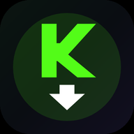
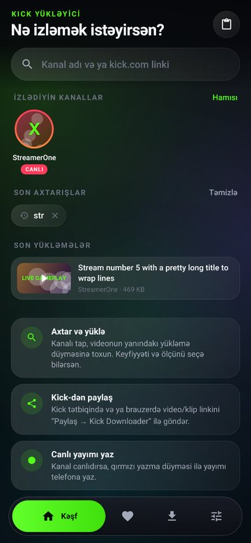
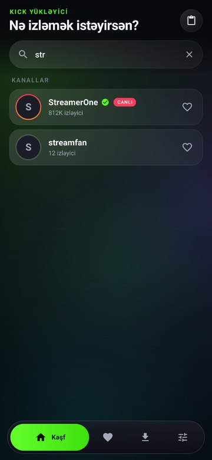
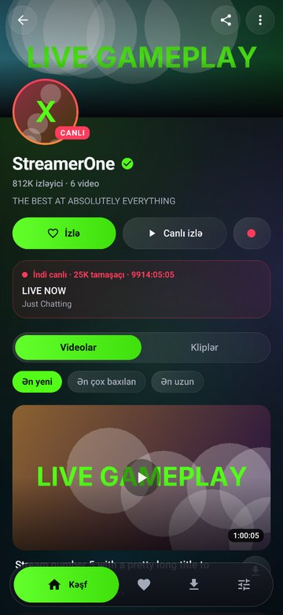
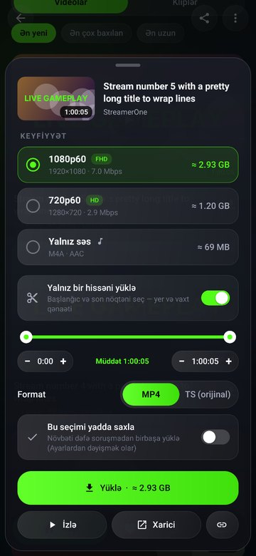
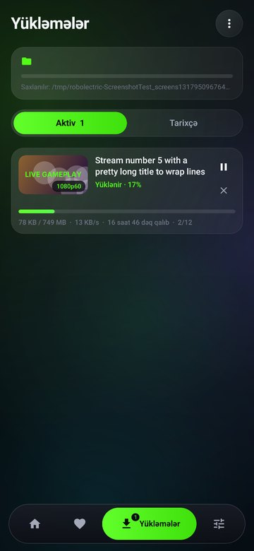
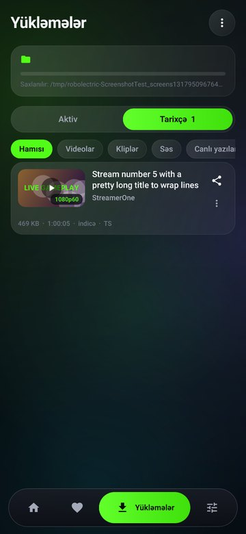
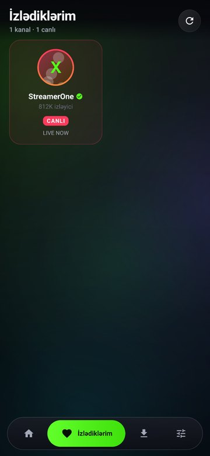
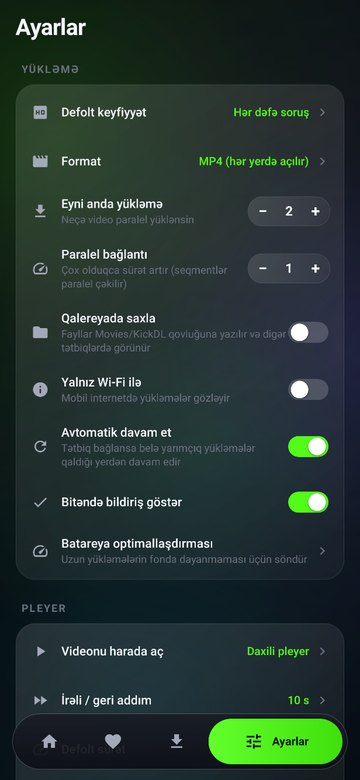

#  Kick Downloader (Android)

Kick.com kanallarının yayım arxivlərini (VOD), kliplərini və canlı yayımlarını telefona yükləyən, minimalist **glassmorphism** dizaynlı Android tətbiqi. Heç bir xarici kitabxana yoxdur — yalnız Android framework API-ləri (APK ≈ 210 KB).

**APK:** [`dist/KickDownloader.apk`](dist/KickDownloader.apk) · Android 8.0+ (API 26)

| Kəşf | Axtarış | Kanal | Keyfiyyət seçimi |
|---|---|---|---|
|  |  |  |  |
| **Yükləmələr (canlı)** | **Tarixçə** | **İzlədiklərim** | **Ayarlar** |
|  |  |  |  |

## İmkanlar

**Axtarış və kanal**
- Təpədə axtarış paneli: kanal adı yaz (canlı nəticələr, 450 ms debounce) və ya `kick.com/...` linkini yapışdır / paylaş
- Kanal səhifəsi: banner, avatar (canlıdırsa qırmızı halqa), izləyici sayı, bio, **CANLI** kartı
- Videolar və Kliplər tabları; videolar üçün *Ən yeni / Ən çox baxılan / Ən uzun*, kliplər üçün *Populyar / Ən yeni* sıralaması, kliplərdə səhifələmə
- Böyük 16:9 kartlar: müddət, baxış sayı, tarix, kateqoriya, yükləmə vəziyyəti (kartın üstündə progress bar)

**Yükləmə**
- Hər videonun yanında morf edən düymə: yüklə → halqa progress → fasilə/davam → ✓
- Keyfiyyət pəncərəsi: bütün keyfiyyətlər (1080p60, 720p60, …), **real ölçü (MB/GB)** — seqmentlərin ölçüsü nümunə götürülərək hesablanır, *Yalnız səs (M4A)*
- **Hissəni kəs (trim):** başlanğıc/son seçib yalnız lazım olan hissəni yüklə (±10 s dəqiq tənzimləmə)
- Format: **MP4** (itkisiz remux, hər yerdə açılır) və ya **TS** (orijinal axın)
- Paralel seqment yükləmə (1–10 bağlantı), eyni anda 1–4 yükləmə, növbə
- Pause / resume / ləğv; tətbiq bağlansa belə qaldığı yerdən davam edir
- **Canlı yayımı yaz:** kanal canlıdırsa qırmızı düymə ilə yayımı yaz, istədiyin an dayandır
- Bildiriş panelində canlı progress (faiz, sürət), bitəndə bildirişdən birbaşa oynat
- Yalnız Wi-Fi rejimi, yaddaş yoxlaması (yer azdırsa xəbərdarlıq)
- Fayllar `Movies/KickDL` (səs: `Music/KickDL`) qovluğuna — qalereyada görünür

**Tarixçə və izləmə**
- Aktiv / Tarixçə tabları, filtrlər (Video, Klip, Səs, Canlı yazılar), paylaş, xarici pleyerdə aç, sil
- **İzlə (follow):** kanalları hesabsız, lokal izlə — ana səhifədə sürətli keçid, canlı status, *“N yeni video”* nişanı

**Pleyer** (daxili, və ya istənilən xarici pleyer — VLC, MX və s.)
- İkiqat toxunuş ilə ±10 s (ardıcıl toxunuşlar toplanır: −10, −20, −30…), ±10 düymələri
- Jestlər: sol tərəf — parlaqlıq, sağ — səs, üfüqi sürüşdürmə — zamanda irəli/geri, uzun basma — müvəqqəti 2×
- Ekranı fırlat (avto / üfüqi kilid / şaquli kilid), toxunuş kilidi, pinch-zoom və sürüşdürmə
- Görüntü rejimləri: sığdır / doldur / uzat / 16:9 / 4:3
- Sürət 0.25×–3×, onlayn yayımda keyfiyyət seçimi, **şəkil-içində-şəkil (PiP)** idarə düymələri ilə
- Ekran şəkli, yuxu taymeri, səs gücləndirici (+15 dB-ə qədər), qaldığın yerdən davam, klaviatura/qulaqlıq düymələri

**Dizayn**
- Tünd glassmorphism: yarımşəffaf şüşə panellər, yumşaq hərəkət edən rəng ləkələri (söndürülə bilər), Kick yaşılı aksent
- Yumşaq animasiyalar: ekran keçidləri, sürüşən seçici, yay effektli düymələr, shimmer skeletlər, vibrasiya rəyi
- Azərbaycan və İngilis dili

## Necə işləyir
- Kick-in sayt API-si (`kick.com/api/v2/channels/{kanal}`, `/videos`, `/clips`, `/api/search`, `v1/video/{uuid}`, `v2/clips/{id}`) istifadə olunur.
- Kick API Cloudflare arxasındadır. Birbaşa sorğu bloklansa, tətbiq gizli WebView daxilində (real Chromium) `fetch` ilə sorğu edir. Nadir hallarda interaktiv yoxlama lazımdırsa **“Doğrula”** düyməsi kick.com-u açır — bir dəfə keçmək kifayətdir.
- Videolar HLS (m3u8) seqmentləri kimi paralel yüklənir, sonra `MediaExtractor` + `MediaMuxer` ilə itkisiz MP4-ə çevrilir (çevirmə alınmasa və ya fayl 3.9 GB-dan böyükdürsə orijinal TS saxlanılır — VLC/MX və daxili pleyer açır).

**Qeydlər:** abunəçilərə özəl VOD-lar (HTTP 403) yüklənmir. Bu tətbiq Kick ilə əlaqəli deyil — yalnız şəxsi istifadə üçün, yaradıcıların hüquqlarına hörmət edin.

## Build
```bash
sudo apt install android-sdk-build-tools zipalign apksigner dalvik-exchange   # aapt2 29, dx
./build.sh            # -> dist/KickDownloader.apk (keystore/release.keystore, parol: android)
```
`build.sh` Gradle/Android Studio olmadan işləyir: `aapt2` (resurslar API 32-yə qarşı), `javac` (API 35 framework), `dx`, `zipalign`, `apksigner`.

## Testlər
Robolectric ilə JVM-də real Android framework kodu üzərində: axtarış → kanal → izləmə → keyfiyyət pəncərəsi → yükləmə → tarixçə; trim, pause/resume, ləğv, canlı yazma, birbaşa MP4 klip, HLS parser, link analizi, API parsing; native qrafika ilə skrinşotlar.
```bash
./test/setup-monitor.sh                 # bir dəfə
./build.sh && gradle -p test cleanTest test   # skrinşotlar: test/build/shots/
```
